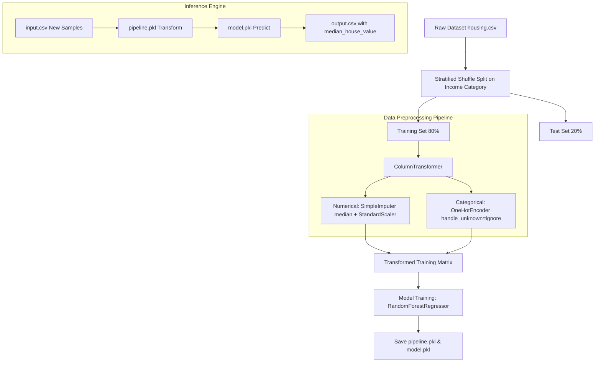

# 🏙️ Project Gurgaon: Housing Price Prediction Pipeline

[](https://www.python.org/)
[](https://scikit-learn.org/)
[](https://pandas.pydata.org/)
[](https://numpy.org/)
[](https://opensource.org/licenses/MIT)
[]()

An end-to-end Machine Learning pipeline for real estate valuation and housing price prediction. This project implements robust data preprocessing, stratified train-test sampling, multi-model evaluation with 10-fold cross-validation, and an automated inference system capable of generating predictions on batch inputs.

---

## 📌 Table of Contents

- [Overview](#-overview)
- [System Architecture](#-system-architecture)
- [Key Features](#-key-features)
- [Dataset Overview](#-dataset-overview)
- [Model Evaluation & Benchmarks](#-model-evaluation--benchmarks)
- [Project Structure](#-project-structure)
- [Getting Started](#-getting-started)
  - [Prerequisites](#prerequisites)
  - [Installation](#installation)
- [Usage & Execution](#-usage--execution)
  - [1. Running the Automated Pipeline](#1-running-the-automated-pipeline)
  - [2. Model Comparison & Cross-Validation](#2-model-comparison--cross-validation)
  - [3. Batch Inference](#3-batch-inference)
- [Input / Output Schema](#-input--output-schema)
- [Roadmap & Enhancements](#-roadmap--enhancements)
- [License](#-license)
- [Author](#-author)

---

## 📖 Overview

Predicting property values accurately requires addressing common real-world challenges:
- **Skewed distributions & outliers** in demographic and income metrics.
- **Missing values** across numerical columns (e.g., missing bedroom counts).
- **Heterogeneous feature types** mixing continuous attributes with categorical labels.
- **Overfitting & bias** when evaluating complex non-linear regressors.

This repository demonstrates best practices in Scikit-Learn:
1. **Stratified Sampling:** Income categorization guarantees proportional representation between training and testing splits.
2. **Modular ColumnTransformer Pipeline:** Automatically handles numerical imputation (`SimpleImputer`), feature scaling (`StandardScaler`), and categorical encoding (`OneHotEncoder`).
3. **Model Selection:** Compares Baseline Linear Regression, Decision Trees, and Random Forest Regressors using **10-fold Negative Root Mean Squared Error (`neg_root_mean_squared_error`)**.
4. **Persistent Artifacts:** Serializes trained pipelines (`pipeline.pkl`) and model weights for fast inference.

---

## 🏗️ System Architecture



---

## ✨ Key Features

- **Stratified Stratification:** Segregates `median_income` into discrete strata `[1, 2, 3, 4, 5]` to prevent sampling bias.
- **Leak-Free Transformation:** Imputation statistics and scalers are fitted exclusively on the training partition and seamlessly applied during inference.
- **Self-Healing Training Phase:** If precomputed weights (`model.pkl` / `pipeline.pkl`) are missing, `main.py` detects this and trains the model automatically in ~3 seconds.
- **Standardized I/O:** Ready-to-use CSV batch prediction pipeline (`input.csv` $\to$ `output.csv`).

---

## 📊 Dataset Overview

The dataset (`housing.csv`) contains metrics derived from census tracts with the following feature set:

| Feature | Type | Description |
|---|---|---|
| `longitude` | Float | Longitudinal coordinate of the property block |
| `latitude` | Float | Latitudinal coordinate of the property block |
| `housing_median_age` | Float | Median age of houses in the block |
| `total_rooms` | Float | Total count of rooms within the block |
| `total_bedrooms` | Float | Total count of bedrooms (contains missing values) |
| `population` | Float | Total inhabitants residing in the block |
| `households` | Float | Total number of households (family units) |
| `median_income` | Float | Median income for households (in tens of thousands USD) |
| `ocean_proximity` | Categorical | Proximity category (`<1H OCEAN`, `INLAND`, `NEAR OCEAN`, `NEAR BAY`, `ISLAND`) |
| **`median_house_value`** | Float | **Target variable**: Median house price |

---

## 📈 Model Evaluation & Benchmarks

Using **10-Fold Cross-Validation** evaluated by Root Mean Squared Error (RMSE) in `main_old.py`:

| Model | Mean RMSE | Std Dev | Min RMSE | Max RMSE | Notes |
|---|---|---|---|---|---|
| **Linear Regression** | ~$69,204 | $2,500 | $65,318 | $73,003 | Linear baseline; exhibits high bias under-fitting complex geo-spatial interactions |
| **Decision Tree Regressor** | ~$69,119 | $2,360 | $65,730 | $73,197 | Severe overfitting on single splits without pruning |
| **Random Forest Regressor** | **~$49,463** | **$2,113** | **$46,405** | **$53,003** | **Best performing model**; drops prediction error by >$20,000 |

---

## 📁 Project Structure

```text
project-gurgaon/
├── .gitignore             # Excludes environments, caches, and large binary model checkpoints
├── LICENSE                # MIT Open Source License
├── README.md              # Comprehensive project documentation
├── requirements.txt       # Python dependencies
├── housing.csv            # Training & validation dataset
├── input.csv              # Sample query input for inference
├── output.csv             # Inferred output with predicted house values
├── main.py                # Main end-to-end training & batch inference script
├── main_old.py            # Comparative evaluation & 10-fold cross-validation script
└── pipeline.pkl           # Exported Scikit-Learn data transformation pipeline
```

---

## 🚀 Getting Started

### Prerequisites

- Python 3.10, 3.11, 3.12, 3.13, or 3.14
- Git

### Installation

1. **Clone the repository:**
   ```bash
   git clone https://github.com/awasthi69/project-gurgaon.git
   cd project-gurgaon
   ```

2. **Create and activate a virtual environment:**
   - **Windows:**
     ```powershell
     python -m venv .venv
     .venv\Scripts\activate
     ```
   - **Linux / macOS:**
     ```bash
     python3 -m venv .venv
     source .venv/bin/activate
     ```

3. **Install dependencies:**
   ```bash
   pip install --upgrade pip
   pip install -r requirements.txt
   ```

---

## 💻 Usage & Execution

### 1. Running the Automated Pipeline

Execute the core script to train the model (if not already trained) and generate predictions:

```bash
python main.py
```

**Output:**
```text
Existing model and pipeline loaded.
Inference complete. Results saved to output.csv
   longitude  latitude  housing_median_age  ... ocean_proximity  median_house_value
0    -122.23     37.88                41.0  ...        NEAR BAY           446573.16
```

*(Note: If `model.pkl` is not present, `main.py` automatically trains the Random Forest model on `housing.csv` in ~3-4 seconds and serializes the pipeline).*

### 2. Model Comparison & Cross-Validation

To benchmark Linear Regression, Decision Trees, and Random Forests using 10-fold cross-validation:

```bash
python main_old.py
```

### 3. Batch Inference

1. Open `input.csv` and add your feature rows matching the schema.
2. Run `python main.py`.
3. Read the generated predictions in `output.csv`.

---

## 📋 Input / Output Schema

### Sample `input.csv`:
```csv
longitude,latitude,housing_median_age,total_rooms,total_bedrooms,population,households,median_income,ocean_proximity
-122.23,37.88,41.0,880.0,129.0,322.0,126.0,8.3252,NEAR BAY
```

### Generated `output.csv`:
```csv
longitude,latitude,housing_median_age,total_rooms,total_bedrooms,population,households,median_income,ocean_proximity,median_house_value
-122.23,37.88,41.0,880.0,129.0,322.0,126.0,8.3252,NEAR BAY,446573.16
```

---

## 🔮 Roadmap & Enhancements

- [ ] **Hyperparameter Tuning:** Implement `GridSearchCV` or `RandomizedSearchCV` on `n_estimators`, `max_features`, and `max_depth`.
- [ ] **Web Interface:** Build an interactive UI with **Streamlit** or **Gradio** for real-time price estimation.
- [ ] **REST API:** Package the pipeline into a **FastAPI** service with Pydantic validation schemas.
- [ ] **Containerization:** Provide a production-ready `Dockerfile` and `docker-compose.yml`.

---

## 📄 License

This project is licensed under the [MIT License](LICENSE) - see the LICENSE file for details.

---

## 👨‍💻 Author

**Parash Awasthi**
- GitHub: [@awasthi69](https://github.com/awasthi69)
- Portfolio: www.parashmaniawasthi.com.np

⭐️ If you find this project helpful, please consider starring the repository!
